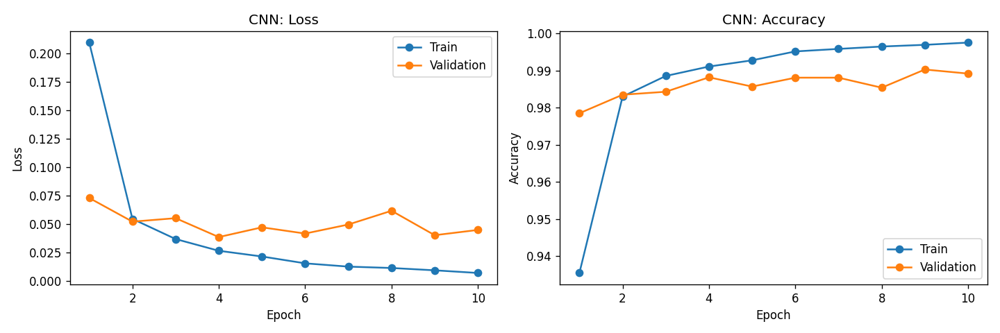
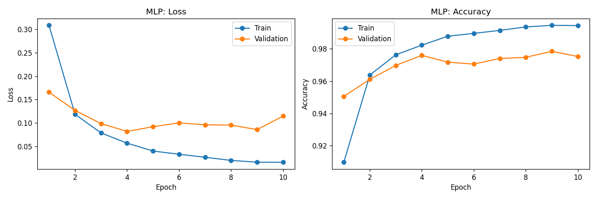
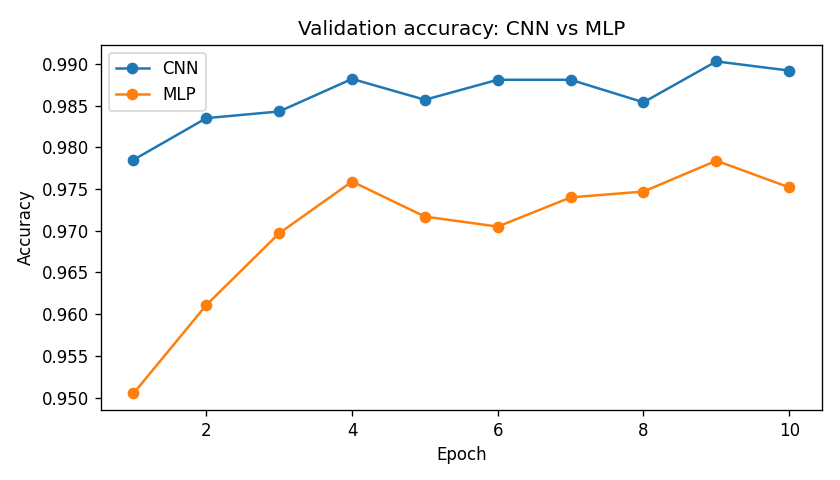
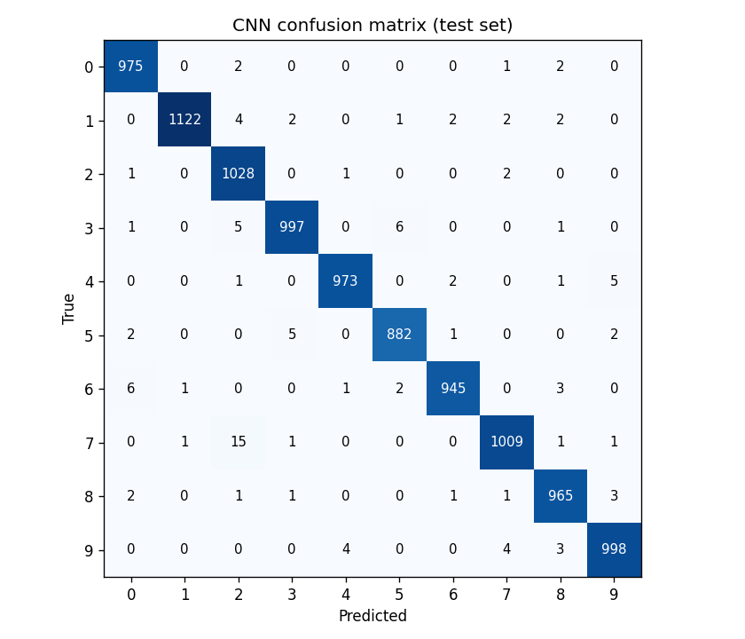
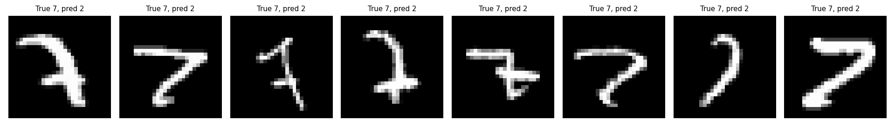
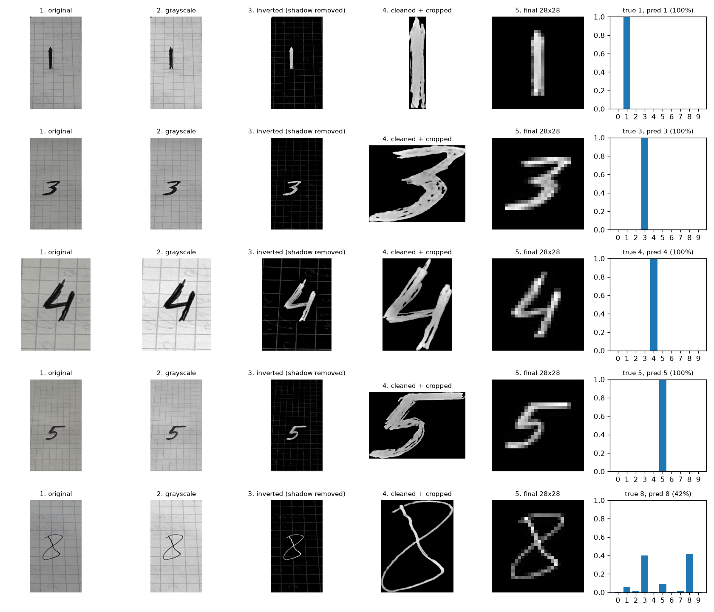

# Handwritten Digit Classifier with a CNN (MNIST)

A convolutional neural network trained **from scratch** on MNIST, compared against a plain MLP baseline under identical conditions, and tested on real handwritten digits that never appeared in MNIST.

**Framework:** PyTorch · **Plots:** matplotlib · **Hardware:** CPU only (Google Colab free tier)

## Results at a glance

| Model | Parameters | Test loss | Test accuracy | Test errors (of 10,000) |
|---|---|---|---|---|
| **CNN** | 421,642 | **0.0384** | **98.94%** | **106** |
| MLP baseline | 235,146 | 0.1087 | 97.38% | 262 |

The CNN makes **2.5× fewer mistakes** than the MLP trained on the same data, splits and number of epochs.

---

## 1. Data pipeline

MNIST is loaded with `torchvision.datasets.MNIST` **without any transforms**, so every processing step is visible in the notebook:

1. Raw images are `uint8` tensors of shape `[60000, 28, 28]` with values 0–255.
2. **Normalization:** converted to float and divided by 255 → values in 0–1.
3. **Channel dimension added:** `[N, 28, 28]` → `[N, 1, 28, 28]`, as convolution layers expect.
4. **Explicit three-way split** (the official test set is never used for validation):

| Split | Images | Source | Used for |
|---|---|---|---|
| Train | 50,000 | official train set | learning the weights |
| Validation | 10,000 | official train set (random, `seed=42`) | monitoring overfitting each epoch |
| Test | 10,000 | official test set | final evaluation, used once per model |

The training set is balanced: every digit has between 5,421 (digit 5) and 6,742 (digit 1) examples.

## 2. CNN architecture

| # | Layer | Output shape | Parameters | Purpose |
|---|---|---|---|---|
| – | Input | `1 × 28 × 28` | – | grayscale image |
| 1 | Conv2d(1→32, 3×3, padding 1) + ReLU | `32 × 28 × 28` | 320 | 32 filters detect simple local patterns (edges, strokes) |
| 2 | MaxPool2d(2) | `32 × 14 × 14` | 0 | downsample, tolerate small shifts |
| 3 | Conv2d(32→64, 3×3, padding 1) + ReLU | `64 × 14 × 14` | 18,496 | combine edges into curves, loops, corners |
| 4 | MaxPool2d(2) | `64 × 7 × 7` | 0 | downsample again |
| 5 | Flatten | `3136` | 0 | feature maps → vector for the dense head |
| 6 | Linear(3136→128) + ReLU | `128` | 401,536 | combine features to reason about the digit |
| 7 | Linear(128→10) | `10` | 1,290 | one score per digit (softmax is inside the loss) |
| | **Total** | | **421,642** | |

Only ~19,000 parameters are in the convolution layers: each 3×3 filter is **reused at every position** of the image. That weight sharing, not the parameter count, is what gives the CNN its advantage.

**Anti-cheat:** the network is built from `nn.Sequential` with random initialization (`torch.manual_seed(42)`). No pretrained weights or transfer learning are used. Before training it scored **14.92%** on validation, i.e. random guessing.

## 3. MLP baseline

```
Flatten(784) → Linear(784→256) → ReLU → Linear(256→128) → ReLU → Linear(128→10)
```

235,146 parameters. It flattens the image first, so it has no notion of which pixels are neighbors.

**Fair comparison:** both models use the same `train_model()` function, so everything except the architecture is identical:

- same 50,000 / 10,000 / 10,000 split
- same batch size (64) and batch order (`seed=42`)
- same loss (`CrossEntropyLoss`), optimizer (Adam), learning rate (0.001)
- same number of epochs (10)

## 4. Training curves





**Observations**

- The CNN after a **single epoch (97.85% val)** already matched the MLP's best result after nine epochs (97.84%), and stayed above the MLP at every epoch.
- **CNN:** validation loss reached its minimum at epoch 4 (0.0386) and then stopped improving while training loss kept falling to 0.0071. This is mild overfitting after epoch 4; validation accuracy still stayed around 99%.
- **MLP:** overfits more clearly. Validation loss bottomed out at epoch 4 (0.0822) and rose to 0.1148 by epoch 10, while training accuracy climbed to 99.4%. Without spatial structure it memorizes pixel positions instead of learning shape patterns.

## 5. Confusion matrix (CNN, test set)



| Most confused pairs | Count |
|---|---|
| **True 7 → predicted 2** | **15** |
| True 3 → predicted 5 | 6 |
| True 6 → predicted 0 | 6 |
| True 4 → predicted 9 | 5 |
| True 3 → predicted 2 | 5 |

**Most confused pair: 7 → 2** (15 of 106 errors, 2.5× more than any other pair). The reverse (2 → 7) happened only 2 times, so the confusion is one-directional.



**Hypothesis:** most of these 7s either have a bottom stroke that curls to the left or a horizontal crossbar through the middle (European style). Both add a horizontal stroke in the lower half, which is the defining feature of a 2's base. MNIST was collected mostly from US writers, who rarely cross their 7s, so the model saw few such examples during training. A few of the samples are ambiguous even to a human.

## 6. Custom handwritten digits

The CNN was tested on photos of digits written on paper and taken with a phone, loaded in a **separate script** from the saved weights.



**Preprocessing** (`preprocess.py`), shown step by step in the figure:

1. **Fix rotation** from the phone's EXIF data
2. **Grayscale** (3 channels → 1)
3. **Invert relative to the local background**: subtract the photo from a heavily blurred copy, so dark ink becomes bright and shadows disappear (MNIST is white on black)
4. **Clean**: keep strong strokes, keep only large connected blobs (removes grid lines and specks), then **crop** to the digit
5. **Resize** the longer side to 20 px (keeping proportions) and **center** on a 28×28 black canvas, like MNIST
6. **Normalize** to 0–1, the same as the training data

| Image | True | Predicted | Confidence | Correct |
|---|---|---|---|---|
| `1.jpeg` | 1 | 1 | 100% | ✓ |
| `3.jpeg` | 3 | 3 | 100% | ✓ |
| `4.jpeg` | 4 | 4 | 100% | ✓ |
| `5.jpeg` | 5 | 5 | 100% | ✓ |
| `8_thin.jpeg` | 8 | 8 | 42% | ✓ (3 got 40%) |

**5 / 5 correct**, on grid paper, without retraining.

**Stroke thickness matters:** the four digits written with a thick marker were all classified with 100% confidence. The 8 written with a thin pen was barely correct: 42% for 8 against 40% for 3. After shrinking to 28×28, the thin strokes become faint and broken, and the left side of the 8 almost disappears. An 8 with a weak left side looks like a 3. MNIST digits have thick strokes, so thin handwriting is outside what the model was trained on.

**What went wrong first, and the fix:** the first version inverted the whole image with `255 − pixel`. A shadow on the photo became bright after inversion and was treated as ink, and the grid paper lines survived too, so the final 28×28 image no longer looked like an MNIST digit. The model predicted **2 (75%) for a 7**. Inverting relative to a blurred background and keeping only the largest connected strokes fixed it: **the same photo was then predicted as 7 (94%)**. In real-world use, preprocessing matters as much as the model.

## 7. Model persistence

The trained weights are saved with `torch.save(cnn.state_dict(), "models/cnn_mnist.pt")` (~1.6 MB).

To prove inference works without retraining, a **brand new** network is built with `build_cnn()`:

| Model | Test accuracy |
|---|---|
| Fresh network, random weights | ~10% |
| Same network after `load_state_dict` | **98.94%** |
| Original trained model | 98.94% |

`predict.py` does the same thing as a standalone script.

## How to run

```bash
git clone <this-repo-url>
cd mnist-cnn
python -m venv .venv
source .venv/bin/activate        # Windows: .venv\Scripts\activate
pip install -r requirements.txt
```

**Train and reproduce every result:** open `train.ipynb` and run all cells (MNIST downloads automatically into `data/`).

**Predict your own digits with the saved model:**

```bash
python predict.py my_digits/*.jpeg --plot images/custom_digits.png
```

Name each photo starting with its true digit (`3.jpeg`, `7_crossed.jpeg`) so the script can mark it correct or wrong. For best results use white unlined paper, a thick marker and even lighting.

## Project structure

```
mnist-cnn/
├── README.md
├── requirements.txt
├── train.ipynb          # data pipeline, training, comparison, plots, confusion matrix
├── model.py             # build_cnn() and build_mlp()
├── preprocess.py        # photo → MNIST-style 28×28 tensor
├── predict.py           # loads saved weights and predicts photos (no training)
├── models/
│   └── cnn_mnist.pt     # trained CNN weights
├── my_digits/           # real handwritten digit photos
└── images/              # plots used in this README
```

## Possible next steps

- Data augmentation (small rotations and shifts) to improve robustness on real handwriting
- Dropout or batch normalization to reduce the overfitting seen after epoch 4
- Visualize the 32 learned filters of the first convolution layer
- A small FastAPI endpoint that accepts an uploaded image and returns the predicted digit

## Dataset

MNIST: http://yann.lecun.com/exdb/mnist/
